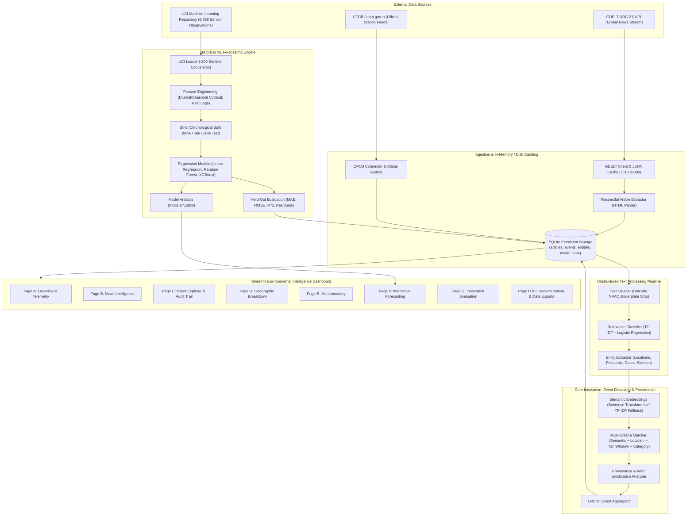
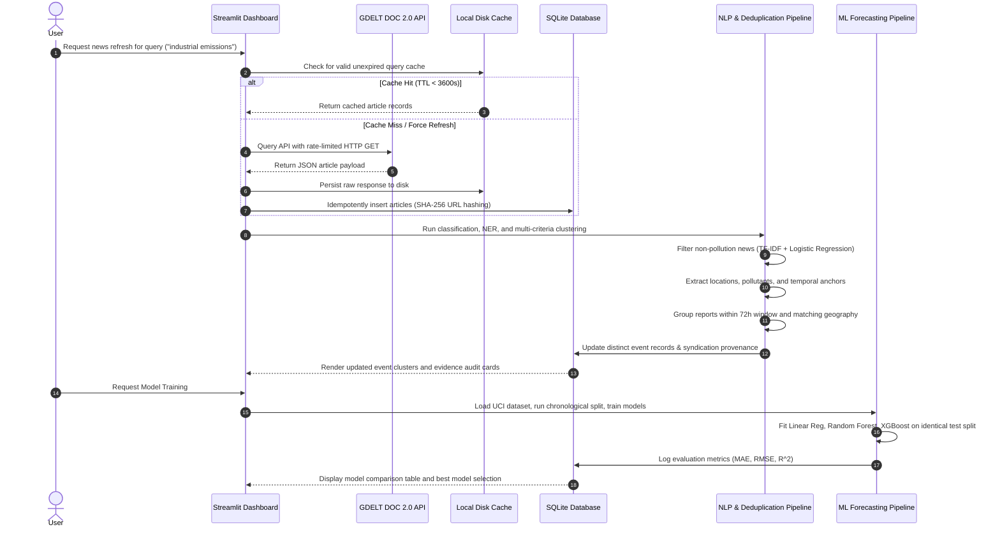

# System Architecture: Evidence-Aware Pollution Event Discovery and Air-Quality Prediction

## 1. Architectural Overview

The platform implements an end-to-end data science ecosystem combining real-time unstructured news ingestion, multi-criteria natural language processing (NLP), duplicate-resistant event discovery, and historical pollutant concentration forecasting.

The architecture enforces strict separation between:
1. **Live Unstructured News Stream** (GDELT DOC 2.0 API)
2. **Official Ambient Monitoring Feeds** (Central Pollution Control Board / data.gov.in)
3. **Historical Empirical Sensor Benchmark** (UCI Machine Learning Repository Air Quality Dataset)
4. **Predictive Inference Engine** (Trained regression models)

---

## 2. Mermaid System Architecture Diagram

---

## 3. Workflow Progression Diagram

---

## 4. Key Subsystem Specifications

### 4.1 Ingestion & Idempotency
- **GDELT Client:** Implements exponential timeout handling (default 20s), bounded response sizes, and deterministic SHA-256 caching.
- **Article Extractor:** Respects robots constraints, HTTP 401/403 paywalls, and strips boilerplate navigation markup without losing pollutant formulas (`PM2.5`, `SO2`, `NOx`).
- **Idempotent Ingestion:** Articles are keyed by `art_` + SHA-256 of canonical URL. Repeated runs never duplicate database records.

### 4.2 NLP and Event Discovery
- **Relevance Classifier:** Supervised TF-IDF baseline with a transparent ground-truth labeling corpus distinguishing real industrial/agricultural pollution from sports, financial, and political distractions.
- **Entity Extractor:** Rule-based gazetteer and regex patterns for 30+ environmental hubs, chemical pollutants, and source taxonomies.
- **Deduplication Engine:** Integrates cosine similarity with geographic boundary matching, 72-hour temporal windows, and source syndication checks.

### 4.3 Machine Learning Forecasting
- **Dataset:** UCI Air Quality Multisensor dataset (9,358 hourly observations).
- **Target:** Carbon Monoxide true concentration `CO(GT)` in $mg/m^3$.
- **Validation:** Chronological split (80% train, 20% test). Transformation medians are calculated exclusively on training partitions to prevent data leakage.
