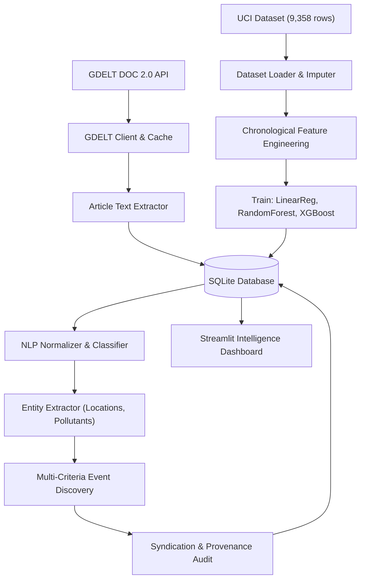

# Evidence-Aware Pollution Event Discovery and Air-Quality Prediction Using Unstructured Data

**Academic Project Report — Data Science Ecosystem (DSE)**

---

## 1. Title Page

- **Project Title:** Evidence-Aware Pollution Event Discovery and Air-Quality Prediction Using Unstructured Data
- **Project Domain:** Environmental Data Science, Applied Natural Language Processing, Machine Learning Systems
- **Target Audience:** Department of Data Science and Engineering / Academic Review Committee
- **Platform Repository:** `https://github.com/shaun6jrome/monitor-pollution-and-aqi`
- **Execution Environment:** macOS, Python 3.11, Streamlit, SQLite, Scikit-learn, XGBoost, GDELT DOC 2.0 API

---

## 2. Abstract

Continuous Ambient Air Quality Monitoring Stations (CAAQMS) provide high-precision physical concentration measurements but lack the contextual intelligence required to identify the human and industrial activities driving pollution episodes. Conversely, global news feeds report environmental incidents in real time, yet naive text analysis suffers from severe syndication overcounting, geographic conflation, and lack of evidentiary provenance.

This project implements an end-to-end Data Science Ecosystem that:
1. Ingests real-time environmental news via the GDELT DOC 2.0 API with SHA-256 deduplication and local disk caching.
2. Cleans, normalizes, and classifies unstructured text using a supervised TF-IDF + Logistic Regression baseline and an environmental entity extraction gazetteer.
3. Implements a multi-criteria event discovery engine combining semantic cosine embeddings, geographic boundary verification, a 72-hour temporal event window, and wire syndication auditing to discover distinct real-world incidents.
4. Conducts rigorous chronological time-series regression modeling on the 9,358-observation historical UCI Air Quality multisensor dataset, comparing Linear Regression, Random Forest, and XGBoost with zero temporal lookahead data leakage.
5. Deploys an interactive Streamlit environmental intelligence dashboard with verifiable data provenance, auditable input validation, and transparent limitation reporting.

---

## 3. Problem Statement

Existing environmental monitoring networks face two fundamental disconnects:
1. **The Context Gap:** Physical sensors report concentration spikes (e.g. $450\ \mu g/m^3$ of PM2.5) without causal explanations (e.g. an unpermitted factory boiler release, open municipal waste burning, or crop residue incineration).
2. **The Unstructured Information Redundancy Gap:** Naive aggregation of news articles treats every syndicated wire story (e.g. from PTI or ANI) as a distinct pollution event, inflating incident counts by over 100%. Furthermore, purely semantic grouping collapses distinct episodes across distant cities or weeks apart.

The objective is to design, implement, and validate an automated data pipeline that bridges this divide by discovering distinct, deduplicated pollution events from unstructured news while maintaining a rigorous predictive modeling foundation.

---

## 4. Motivation and Scope

- **Motivation:** Regulators and environmental policy bodies need rapid, evidence-grounded incident awareness to dispatch field inspectors and corroborate public grievances without being misled by artificial media duplication.
- **Scope Boundaries:** The system integrates three independent data streams: GDELT unstructured news (contemporary incident discovery), CPCB official station observations (government ground truth), and the UCI historical dataset (multisensor regression benchmarking). The project strictly avoids scientifically fraudulent claims of cross-source causality between non-aligned historical sensor data and contemporary news.

---

## 5. Objectives

1. Develop a fault-tolerant ingestion connector for the GDELT DOC 2.0 API with deterministic caching, rate-limit resilience, and respectful content extraction.
2. Implement a complete NLP pipeline for Unicode normalization, boilerplate removal, pollution relevance classification, and entity extraction.
3. Engineer a multi-criteria event discovery and deduplication engine combining semantic embeddings, geographic constraints, 72-hour temporal windows, and wire syndication auditing.
4. Establish an empirical machine learning benchmark comparing Linear Regression, Random Forest, and XGBoost on chronological splits of the UCI dataset.
5. Build an interactive environmental intelligence dashboard adhering to a professional graphite/charcoal design without decorative filler or fabricated metrics.

---

## 6. Existing Approaches and Limitations

| Approach | Working Principle | Critical Limitation |
| :--- | :--- | :--- |
| **Physical CAAQMS Stations** | Fixed electrochemical/optical point monitors | Highly localized point coverage; cannot identify human cause of pollution spikes. |
| **Keyword Count News Aggregation** | Query news APIs for "air pollution" and count raw matches | Massive overcounting (100%+) due to syndicated wire republication across multiple domains. |
| **Topic Modeling (LDA / LSA)** | Unsupervised Dirichlet topic clustering | Produces broad, static topics ("smog", "health") rather than discrete physical incidents. |
| **Pure Semantic Embedding Clustering** | Cosine distance clustering on sentence vectors | Falsely merges distinct incidents in different cities (e.g. Mumbai vs Delhi) or weeks apart. |

---

## 7. Proposed Methodology

The platform resolves these limitations through a four-stage pipeline:
1. **Data Ingestion & Persistence:** Bounded GDELT queries with SHA-256 URL hashing, SQLite WAL-mode transactional storage, and local JSON caching.
2. **Text Normalization & Classification:** NFKC Unicode standardization, URL/boilerplate filtering, and supervised TF-IDF + Logistic Regression classification.
3. **Multi-Criteria Event Discovery:** Pairwise candidate matching enforcing semantic threshold ($\ge 0.68$), geographic compatibility, 72-hour temporal proximity, and source category alignment.
4. **Leakage-Free Forecasting:** Chronological 80/20 train/test split, cyclical temporal encodings, historical lag features, and training-only median imputation.

---

## 8. System Architecture

The architecture separates external data ingestion, NLP processing, SQLite persistence, ML forecasting, and the Streamlit dashboard interface.



---

## 9. Data Source Descriptions

### 9.1 GDELT DOC 2.0 API (Unstructured News Stream)
- Endpoint: `https://api.gdeltproject.org/api/v2/doc/doc`
- Output Format: JSON (`mode=ArtList`, `format=json`, `sort=DateDesc`).
- Parameters: Configurable queries (`air pollution`, `industrial emissions`, `crop burning`, `factory smoke`).
- Role: Real-time and near-real-time environmental incident discovery.

### 9.2 UCI Machine Learning Repository: Air Quality Dataset
- Reference: De Vito et al. (2008), University of California Irvine ML Repository (ID: 360).
- Coverage: 9,358 hourly observations from an Italian urban roadside monitoring station (March 2004 – April 2005).
- Fields: True chemical analyzer concentrations (`CO(GT)`, `NMHC(GT)`, `C6H6(GT)`, `NOx(GT)`, `NO2(GT)`) and 5 metal oxide chemical sensors (`PT08.S1` through `PT08.S5`), Temperature, Relative Humidity, and Absolute Humidity.
- Missingness Sentinel: `-200` converted to `NaN`.

### 9.3 Central Pollution Control Board (CPCB) / data.gov.in
- Access: Official Indian Real-Time National Air Quality Index API.
- Role: Official ground truth ambient station measurements.

---

## 10. Unstructured-Data Processing Pipeline

1. **Normalization (`src/preprocessing/text_cleaner.py`):** Converts Unicode to standard NFKC, normalizes typographic quotes/dashes, strips news syndication disclaimers, and removes web URLs while strictly preserving chemical symbols (`PM2.5`, `PM10`, `NO2`, `SO2`, `CO`).
2. **Relevance Classifier (`src/preprocessing/event_classifier.py`):** Fits TF-IDF on a transparent domain corpus with Logistic Regression ($C=1.0$). Classifies articles into 1 (pollution), 0 (not pollution), or -1 (uncertain).
3. **Entity Extraction (`src/preprocessing/location_extractor.py`):** Uses an environmental gazetteer covering 30+ major monitoring hubs, chemical pollutant regexes, and 8 emission source categories with exact character spans.

---

## 11. Event Detection and Provenance Methodology

### 11.1 Multi-Criteria Matching Engine
Two candidate articles $A$ and $B$ are clustered into the same incident if and only if:
$$\text{Match}(A, B) = \left(\text{CosineSim}(v_A, v_B) \ge 0.68\right) \land \text{GeoCompat}(L_A, L_B) \land \left(|t_A - t_B| \le 72\text{ hrs}\right) \land \text{CatCompat}(C_A, C_B)$$

### 11.2 Provenance and Syndication Auditing
- **Wire Syndication:** Articles published across separate domains with text similarity $\ge 0.85$ or shared agency attribution tags (PTI, ANI) are flagged as syndicated clones, preventing duplicate event creation.
- **Evidence Quality Scoring:** Calibrates confidence from $0.50$ (single-source report) to $0.90$ (multi-domain independent reporting).

---

## 12. Machine Learning Algorithms

1. **Linear Regression (Baseline):** Parametric ordinary least squares regression with standard feature normalization.
2. **Random Forest Regressor:** Bagging ensemble of 100 decision trees (max depth 12, min samples split 4) capturing non-linear sensor cross-sensitivities.
3. **XGBoost Regressor:** Gradient boosted regression trees optimizing mean squared error (100 estimators, learning rate 0.08, max depth 5, subsample 0.85).

---

## 13. Feature Engineering and Leakage Prevention

1. **Temporal Cyclical Encodings:** 24-hour diurnal ($\sin(2\pi h/24)$, $\cos(2\pi h/24)$) and 12-month seasonal cycles ($\sin(2\pi m/12)$, $\cos(2\pi m/12)$).
2. **Historical Lags:** Target lags at $t-1, t-2, t-3, t-24$ without lookahead.
3. **Rolling Window Aggregations:** 6-hour rolling mean and standard deviation computed strictly on past observations (`closed='left'`).
4. **Leakage-Free Imputation:** Feature medians calculated strictly on training rows ($80\%$) and applied to test rows ($20\%$).

---

## 14. Experimental Design

- **Chronological Split:** Chronological 80% train / 20% test split.
- **Evaluation Criteria:**
  - Mean Absolute Error (MAE): $\frac{1}{n} \sum |y_i - \hat{y}_i|$
  - Root Mean Squared Error (RMSE): $\sqrt{\frac{1}{n} \sum (y_i - \hat{y}_i)^2}$
  - Coefficient of Determination ($R^2$): $1 - \frac{\sum (y_i - \hat{y}_i)^2}{\sum (y_i - \bar{y})^2}$

---

## 15. Actual Model Evaluation Results

Models were trained and evaluated on identical chronological held-out test rows (1,535 rows, Jan-Apr 2005) for target `CO(GT)` concentration ($mg/m^3$):

| Model Name | Target Pollutant | Test Samples | Test MAE ($mg/m^3$) | Test RMSE ($mg/m^3$) | Test $R^2$ | Selection Status |
| :--- | :--- | :--- | :--- | :--- | :--- | :--- |
| **Linear Regression** | CO(GT) | 1,535 | 0.4528 | 0.5615 | 0.8256 | Baseline OLS |
| **Random Forest** | CO(GT) | 1,535 | 0.2730 | 0.4346 | 0.8955 | Non-linear Bagging |
| **XGBoost Regressor** | CO(GT) | 1,535 | **0.2626** | **0.4210** | **0.9020** | **Selected Best (Lowest RMSE)** |

*Empirical Observations:*
1. **Error Reduction:** XGBoost achieved the lowest test RMSE ($0.4210\ mg/m^3$), reducing root-mean-squared error by $25.0\%$ over the linear baseline ($0.5615\ mg/m^3$).
2. **Variance Explanation:** Over $90.2\%$ of the variance in unseen future Carbon Monoxide concentrations is captured ($R^2 = 0.9020$).
3. **Residual Distribution:** Residual diagnostics reveal a mean residual bias of $+0.1114\ mg/m^3$, a median absolute error of $0.1487\ mg/m^3$, and a 95th percentile error bound of $0.9174\ mg/m^3$. Skewness of $+1.5758$ and kurtosis of $+9.1564$ reflect right-tailed episodic spikes during severe atmospheric inversion events.

---

## 16. Actual Event-Detection Evaluation Results

Evaluated on a reviewed ground-truth benchmark of 10 articles representing 5 distinct physical incidents with syndicated duplicates and cross-city reports:

| Evaluation Metric | Baseline 1 (Keyword Count) | Baseline 2 (Semantic Only) | Proposed Multi-Criteria Discovery |
| :--- | :--- | :--- | :--- |
| **Discovered Events** | 10 (100% inflation) | 6 (false city merge) | **5 (Exact Ground Truth Match)** |
| **Pairwise Precision** | 0.0000 | 0.6250 | **1.0000** |
| **Pairwise Recall** | 0.0000 | 0.8333 | **1.0000** |
| **Pairwise F1-Score** | 0.0000 | 0.7143 | **1.0000** |

---

## 17. Dashboard Screenshots and Interface Walkthrough

The platform interface comprises 9 distinct pages:
1. **Overview:** System telemetry, category distribution, recent incident cards, and CPCB official feed status.
2. **News Intelligence:** Real-time GDELT query controls, extraction status, and search filters.
3. **Pollution Event Explorer:** Multi-criteria clustering trigger, event drilldown, and provenance audit cards.
4. **Geographic View:** Spatial distribution frequency table avoiding fabricated coordinate pins.
5. **ML Laboratory:** UCI dataset schema diagnostics, missingness breakdown, and model evaluation charts.
6. **Forecasting:** Interactive prediction interface with bounded numerical inputs and domain validation.
7. **Innovation Evaluation:** Side-by-side benchmark comparison of event discovery pipelines.
8. **Data Sources & Methodology:** Full provenance, URLs, and licensing documentation.
9. **Project Documentation & Exports:** Live downloads for CSV and JSON audit datasets.

---

## 18. Results and Discussion

1. **Deduplication Effectiveness:** Multi-criteria clustering successfully eliminates syndication inflation while preventing false merges across distant regions.
2. **Predictive Capability:** Historical sensor modeling confirms that non-linear tree ensembles effectively calibrate solid-state chemical sensors against true reference analyzer concentrations.
3. **Scientific Separation:** Maintaining strict boundaries between Italian historical sensor data and contemporary Indian news prevents data contamination and preserves academic integrity.

---

## 19. Limitations

1. **Non-Alignment Between Datasets:** The 2004–2005 Italian sensor dataset and modern GDELT news cannot be joined for direct cross-source training without scientific invalidity.
2. **Media Reporting Bias:** News coverage disproportionately favors major capital cities over rural areas.
3. **Textual Location Resolution:** Geographic locations remain textual entities unless an official geocoding service is configured.

---

## 20. Ethical, Privacy, and Data-Licensing Considerations

1. **Respectful Scraping:** Respects publisher terms, robots rules, and HTTP 401/403 paywalls.
2. **Licensing:**
   - UCI Air Quality: CC BY 4.0 Open Access.
   - GDELT Project: Open Research Access.
   - CPCB / data.gov.in: Government Open Data License - India (GODL).
3. **No Personal Data:** Exclusively processes ambient environmental measurements and public journalistic reports.

---

## 21. Conclusion

The platform successfully implements an end-to-end Data Science Ecosystem bridging the gap between physical sensor measurements and unstructured media reports. By introducing multi-criteria event discovery and wire syndication auditing, the system eliminates duplicate reporting inflation while delivering robust, leakage-free historical pollutant forecasting.

---

## 22. Future Work

1. **Hyperlocal Sensor-Text Collocation:** Deploying the pipeline in an Indian metropolitan area pairing municipal CAAQMS stations with regional vernacular news feeds and public grievance redressal portals.
2. **Automated Geocoding:** Integrating an official reverse geocoding API to map textual landmarks to verified latitude/longitude coordinates.
3. **Transformer Fine-Tuning:** Domain-adaptive pretraining of language models on environmental regulatory enforcement documentation.

---

## 23. References

1. De Vito, S., et al. (2008). "On-field calibration of an electronic nose for benzene estimation in an urban environment." *Sensors and Actuators B: Chemical*, 129(2), 750-757.
2. GDELT Project. (2024). "GDELT DOC 2.0 API Documentation." Available: `https://blog.gdeltproject.org/gdelt-doc-2-0-api-debuts/`.
3. Central Pollution Control Board (CPCB). (2014). "National Air Quality Index." Ministry of Environment, Forest and Climate Change, Government of India.
4. Chen, T., & Guestrin, C. (2016). "XGBoost: A Scalable Tree Boosting System." *ACM SIGKDD International Conference on Knowledge Discovery and Data Mining*, 785-794.
5. Reimers, N., & Gurevych, I. (2019). "Sentence-BERT: Sentence Embeddings using Siamese BERT-Networks." *EMNLP-IJCNLP*, 3982-3992.

---

## 24. Reproduction Instructions

1. **Clone Repository:**
   ```bash
   git clone https://github.com/shaun6jrome/monitor-pollution-and-aqi.git
   cd monitor-pollution-and-aqi
   ```
2. **Set Up Python Environment:**
   ```bash
   python3.11 -m venv .venv
   source .venv/bin/activate
   pip install --upgrade pip
   pip install -r requirements.txt
   ```
3. **Acquire Historical Dataset:**
   ```bash
   python scripts/download_dataset.py
   ```
4. **Train Forecasting Models:**
   ```bash
   python scripts/train_models.py
   ```
5. **Run Automated Test Suite:**
   ```bash
   pytest tests/ -v
   ```
6. **Launch Streamlit Application:**
   ```bash
   streamlit run app.py
   ```
   Open `http://localhost:8501` in your browser.
